# Dependencies, Realistic Implementation Estimates, and Proposed Development Order

**Deliverables 7 and 8 of 8 · Phase 2 · Assessment only — nothing here is a schedule, a commitment or a delivery date.**
Branch `arena/6303ef2f-sentinel-police-management` · commit `a1c2478` · 2026-11-06

---

## 1. How to read these estimates

### 1.1 Units

Effort is expressed in **engineering days**, never in completion percentages. One engineering day = **one developer, one focused working day, including writing the tests and getting the change reviewed**. It does not include meetings, decision-waiting, procurement, legal review or deployment windows.

| Band | Range | Meaning |
|---|---|---|
| **XS** | ≤ 1 day | Single-file, well-understood, low regression risk |
| **S** | 1–3 days | Contained change with tests |
| **M** | 3–8 days | Multiple call sites or a schema touch; real regression risk |
| **L** | 8–20 days | New subsystem or model change across API, UI and tests |
| **XL** | > 20 days | A programme, not a task |
| **U** | *Unestimable* | Blocked by a decision; stating a number would be invention |

**Every estimate is given as a range.** A range is the honest output of this assessment; a single number would imply a confidence the evidence does not support.

### 1.2 What these estimates assume

1. Developers already familiar with this codebase. `backend/server.py` is **10,067 lines** and `index.html` is **13,158 lines**; both are single files. Onboarding an unfamiliar developer adds time not counted here.
2. **A working test environment exists** (WP-01). Today **23 of 25 test suites cannot be executed** — `psycopg2-binary`, `pgserver` and `jsdom@26` are absent and there is no manifest. Until that is fixed, no change can be verified, and *every* estimate below is unsafe.
3. Changes are made on branches with review. No estimate assumes shortcuts.
4. Work is sequenced as proposed in §5. Running packages out of order inflates them, because several share one underlying control.

### 1.3 What these estimates exclude

- Decision latency. Fifteen decisions block Release 1.0 (see `DECISION_REGISTER_RECOMMENDATIONS.md` §2). Waiting time is **not** engineering time and is not counted.
- Legal review, DPIA, procurement, hardware.
- Data migration of existing production records (volume unknown — **D-07**).
- Any biometric capture programme (**D-18**) — see WP-45.
- Training, rollout and operational handover.

### 1.4 Confidence

| Area | Confidence | Why |
|---|---|---|
| Security remediation packages | **Moderate–good** | The defects are read from code; the fixes are well-understood patterns, several of which already exist elsewhere in the same file |
| Fingerprint functional packages | **Moderate** | Scope is clear *if* D-18 settles clearance-only |
| Checkpoint functional packages | **Moderate** | Smallest unit; main unknown is D-27 |
| Crime functional packages | **Low** | D-14 and D-15 are unanswered; the unit's size genuinely is not known |
| Anything biometric | **None** | Unestimable until D-18 |

---

## 2. The three unknowns that dominate everything

| Unknown | Decision | Effect on the total |
|---|---|---|
| Does Fingerprint Release 1.0 include **real biometric capture**? | **D-18** | Clearance-only: the unit is mostly built. Real biometrics: a scanner SDK, an external bridge service (**not in this repository**), server-side template storage, a matching engine and a biometric data policy — **XL, a separate programme** |
| What are **"advanced reports"**? | **D-14** | 8 reports from existing columns ≈ **L**; the full 18 including time-to-closure and per-investigator metrics forces new schema and the assignment model first |
| Are `crime_cases` and `crime_incidents` **one workflow or two**? | **D-15** | Option A ≈ **M**. Option B (merge) is a destructive migration across two UIs, two status vocabularies and two scoping models ≈ **L–XL** |

**Until these three are answered, any total is a guess.** The ranges in §3 assume the *recommended* technical options from the decision register (clearance-only, phased reports R-1…R-8, Option A linkage). **If the owner decides otherwise, the totals change materially** — and that is a property of the unanswered decisions, not of the estimate.

---

## 3. Work package catalogue

### Phase 0 — Enablement *(nothing can be verified without this)*

| WP | Covers | Band | Days | Depends on | Decision |
|---|---|---|---|---|---|
| **WP-01** | **M-10** — dependency manifests (`requirements.txt` / `package.json`) + reproducible test environment; make the 23 unrunnable suites runnable; retire the 2 obsolete harnesses | **S** | 2–4 | — | D-29 (light) |
| **WP-02** | CI pipeline running the full suite on every push | **S** | 2–4 | WP-01 | — |

> **WP-01 is the highest-leverage item in this entire document.** Every other estimate assumes it is done. Without it, "fixed" cannot be distinguished from "believed fixed" — which is exactly the state the project is in now.

### Phase 1 — Security Wave 1 *(must precede any production exposure)*

| WP | Covers | Band | Days | Depends on | Decision |
|---|---|---|---|---|---|
| **WP-03** | **C-2** default credentials: environment-sourced seed, forced first-login change, startup guard | **S** | 2–4 | — | **D-03** |
| **WP-04** | **C-3** PBKDF2-HMAC-SHA256 + per-user salt + transparent re-hash on login | **S** | 2–4 | — | D-03; D-29 only if Argon2 chosen |
| **WP-05** | **C-1 / FG-01 / FG-04** + the person-document half of **H-2a** — authenticated, scoped, audited document retrieval; remove the pre-auth `/uploads/` route | **M** | 4–8 | — | — |
| **WP-06** | **H-2b** fail-closed `branch_scope_view()` across all 10 scoped call sites + startup validation of postings | **M** | 4–8 | WP-01 | — |
| **WP-07** | **M-2** fail-closed `checkpoint_scope()`; mandatory `location_scope` on checkpoint officers | **M** | 2–5 | WP-06 | D-20 *(do together)* |
| **WP-08** | **H-2a / FG-02 / FG-03 / N-2** record-scope checks on the five unscoped write paths | **S** | 2–4 | WP-06 | — |
| **WP-09** | **M-7 / FG-05** upload validation inside `save_upload()` (allow-list + size cap, as `/signed-document` already does) | **XS–S** | 1–2 | — | — |
| | **Phase 1 subtotal** | | **17–35** | | |

### Phase 2 — Accountability and session integrity

| WP | Covers | Band | Days | Depends on | Decision |
|---|---|---|---|---|---|
| **WP-10** | **H-5** last-admin + self-demotion guards; session revocation on password/role/active change | **M** | 3–6 | — | D-09 (two-person rule) |
| **WP-11** | **H-3** absolute expiry, idle timeout, token rotation, administrative session revocation view | **M** | 4–8 | WP-10 | **D-08 (session half)** |
| **WP-12** | **H-4** login success/failure/logout auditing; throttling and lockout | **S** | 2–4 | — | D-03 |
| **WP-13** | **M-3 / FG-06 / FG-07** separation of duties; structured, queryable bypass auditing | **S** | 2–4 | — | **D-06, D-12** |
| **WP-14** | **N-3 / FG-14** branch-scoped analytics for all four builders | **S** | 2–4 | WP-06 | — |
| **WP-15** | **Security regression suite** — the ~30 named verification tests from `SECURITY_REMEDIATION_PRIORITY.md`, none of which exist today | **M–L** | 6–12 | WP-01 | — |
| | **Phase 2 subtotal** | | **19–38** | | |

### Phase 3 — Platform prerequisites *(gate the schema work)*

| WP | Covers | Band | Days | Depends on | Decision |
|---|---|---|---|---|---|
| **WP-16** | **M-11** versioned migrations with a recorded version table, removed from application startup | **M** | 4–8 | WP-01 | — |
| **WP-17** | **N-1** `suspect_alerts.branch_id` + backfill + scoped read/write | **M** | 3–6 | **WP-16** | D-05 |
| **WP-18** | **H-6 / FG-08** sequence-based identifiers, year-correct, unique-constrained | **M** | 2–5 | **WP-16** | — |
| **WP-19** | **H-7** before/after values in audit; append-only enforcement; integrity control; least-privilege DB role (**M-8**) | **M–L** | 4–10 | WP-16 | **D-04** |
| **WP-20** | **H-8** documented, committed TLS/deployment topology; `Secure` cookie; HSTS | **M** | 3–8 | — | **D-01, D-02** |
| **WP-21** | **N-4 / N-5** CORS tightening + security response headers | **XS–S** | 1–2 | — | — |
| | **Phase 3 subtotal** | | **17–39** | | |

### Phase 4 — Fingerprint Unit functional completion *(assumes D-18 = clearance-only)*

| WP | Covers | Band | Days | Depends on | Decision |
|---|---|---|---|---|---|
| **WP-22** | **FG-09 / FG-10** rejection path, reason codes, full status model | **M** | 3–6 | WP-13 | **D-19** |
| **WP-23** | **FG-11** server-side search, filtering and pagination for the clearance register | **M** | 3–6 | WP-06 | D-26-equivalent |
| **WP-24** | **FG-15** supervisor / unit-chief role for the Fingerprint Unit | **M** | 3–6 | WP-13 | D-21-equivalent |
| **WP-26** | **FG-13 / N-6** promote documents to first-class rows (owner, type, hash, retention, access audit) | **L** | 8–15 | **WP-16**, WP-05 | D-04 |
| *WP-25* | *FG-12 certificate verification (QR / online check)* | *M* | *3–8* | — | *D-10 — **deferrable to 1.1*** |
| | **Phase 4 subtotal** *(excluding deferrable WP-25)* | | **17–33** | | |

### Phase 5 — Crime Unit *(the largest body of work in the release)*

| WP | Covers | Band | Days | Depends on | Decision |
|---|---|---|---|---|---|
| **WP-27** | **D-15 Option A** — `source_incident_id` link + conversion action + scoping fix on `/api/crimes` | **M** | 4–8 | WP-16 | **D-15** |
| **WP-28** | **CA-01…CA-04** case assignment model + reassignment history | **L** | 5–10 | WP-16 | **D-21** |
| **WP-29** | **CS-01…CS-06** single status vocabulary + validated state machine + closure authority | **M–L** | 4–8 | WP-28 | **D-25** |
| **WP-30** | **IW-01…IW-03** investigative action log + case timeline | **L** | 5–10 | WP-28 | **D-22** |
| **WP-31** | **SM-07 / SM-08 / SM-10** suspect lifecycle + participant model separation | **L** | 5–10 | WP-17 | **D-23** |
| **WP-32** | **EM-06 / EM-07 / EM-08** evidence hash, chain of custody, audited withdrawal | **L** | 6–12 | WP-26 | **D-24** |
| **WP-33** | **SF-02 / SF-03** server-side search, filtering, pagination | **M–L** | 4–8 | WP-06 | **D-26**, D-07 |
| **WP-34** | **D-14 reports R-1…R-8** scoped, filtered, with export | **L** | 8–15 | WP-14, WP-29 | **D-14** |
| **WP-35** | **Crime Unit test suite** — none exists today | **L** | 5–10 | WP-01 | — |
| | **Phase 5 subtotal** | | **46–91** | | |

### Phase 6 — Checkpoint Unit functional completion

| WP | Covers | Band | Days | Depends on | Decision |
|---|---|---|---|---|---|
| **WP-36** | **G-13** configurable checkpoint catalogue from `police_branches` | **M** | 3–6 | **WP-07** | **D-20** |
| **WP-37** | **G-04** branch-based read filtering alongside location filtering | **S** | 2–4 | WP-06 | — |
| **WP-38** | **G-08 / G-09** officer-recorded outcomes + post-flag workflow | **L** | 5–10 | **WP-31** | **D-27** |
| **WP-39** | **G-10 / G-11** event amendment route + single-event read | **S** | 2–4 | WP-37 | — |
| **WP-40** | **G-14** collapse the three location columns into one | **M** | 3–6 | **WP-16**, WP-36 | — |
| **WP-41** | **G-15** structured search and filtering | **S** | 2–4 | WP-37 | D-26 |
| | **Phase 6 subtotal** | | **17–34** | | |

### Phase 7 — Release readiness

| WP | Covers | Band | Days | Depends on | Decision |
|---|---|---|---|---|---|
| **WP-42** | **D-13 / D-16** module visibility, verified at the **API** gate and not only in the UI | **S** | 2–4 | WP-01 | **D-13, D-16** |
| **WP-43** | Full regression run + evidence for release gates G-1…G-12 (`RELEASE_PLAN.md` §7) | **M** | 4–8 | all | — |
| **WP-44** | **M-12** deployment runbook, backup/restore rehearsal, rollback procedure, monitoring and a DB-aware health check | **M** | 3–6 | WP-20 | **D-09**, D-08 (RPO/RTO) |
| | **Phase 7 subtotal** | | **9–18** | | |

### Deferred / out of the Release 1.0 total

| WP | Covers | Band | Note |
|---|---|---|---|
| **WP-45** | **FG-16…FG-21** biometric capture programme: scanner SDK, the external bridge service (**no code in this repository**), server-side template storage, matching engine, biometric data policy | **U → XL** | **Unestimable until D-18.** If in scope, this is a separate programme with hardware and legal dependencies, not a work package |
| **WP-46** | **G-16** offline/field operation and a designed sync model | **XL** | Blocked on **D-11** |
| **WP-47** | **D-03b** organisational IdP + MFA | **M–L** | 5–12 days; Release 1.1 candidate |

---

## 4. Dependency graph

```mermaid
graph TD
  WP01["WP-01 test environment<br/>(2-4d) — GATES EVERYTHING"]
  WP06["WP-06 fail-closed branch scope<br/>(4-8d) — SHARED CONTROL"]
  WP16["WP-16 versioned migrations<br/>(4-8d) — GATES ALL SCHEMA"]

  WP01 --> WP06
  WP01 --> WP16
  WP01 --> WP15["WP-15 security regression suite"]
  WP01 --> WP35["WP-35 Crime test suite"]
  WP01 --> WP42["WP-42 module visibility"]

  WP06 --> WP07["WP-07 checkpoint fail-closed"]
  WP06 --> WP08["WP-08 record scope on writes"]
  WP06 --> WP14["WP-14 scoped analytics"]
  WP06 --> WP23["WP-23 FP search"]
  WP06 --> WP33["WP-33 Crime search"]
  WP06 --> WP37["WP-37 checkpoint branch reads"]

  WP07 --> WP36["WP-36 checkpoint catalogue (D-20)"]
  WP36 --> WP40["WP-40 collapse location columns"]
  WP16 --> WP40
  WP37 --> WP39["WP-39 amend + single read"]
  WP37 --> WP41["WP-41 checkpoint search"]

  WP16 --> WP17["WP-17 suspect_alerts.branch_id"]
  WP16 --> WP18["WP-18 identifiers"]
  WP16 --> WP19["WP-19 tamper-evident audit (D-04)"]
  WP16 --> WP27["WP-27 incident-case link (D-15)"]
  WP16 --> WP28["WP-28 case assignment (D-21)"]

  WP05["WP-05 authenticated documents"] --> WP26["WP-26 document model"]
  WP16 --> WP26
  WP26 --> WP32["WP-32 chain of custody (D-24)"]

  WP17 --> WP31["WP-31 suspect lifecycle (D-23)"]
  WP31 --> WP38["WP-38 post-flag workflow (D-27)"]

  WP28 --> WP29["WP-29 status state machine (D-25)"]
  WP28 --> WP30["WP-30 investigation log (D-22)"]
  WP29 --> WP34["WP-34 advanced reports (D-14)"]
  WP14 --> WP34

  WP10["WP-10 admin guards"] --> WP11["WP-11 session lifecycle (D-08)"]
  WP13["WP-13 separation of duties (D-06/D-12)"] --> WP22["WP-22 rejection path (D-19)"]
  WP13 --> WP24["WP-24 FP supervisor role"]
```



### 4.1 The three chokepoints

| Chokepoint | Why it is a chokepoint | Consequence of skipping it |
|---|---|---|
| **WP-01 — test environment** | 23 of 25 suites cannot run. Nothing downstream can be verified. | Every subsequent "fix" is unverified belief. This is how the project arrived at an unverifiable "80% complete". |
| **WP-06 — fail-closed branch scope** | One helper (`branch_scope_view()`) governs **ten** scoped call sites across all three units. | Fixing individual routes while the shared helper still fails open leaves the hole open and produces tests that pass for the wrong reason. |
| **WP-16 — versioned migrations** | Five packages need DDL (WP-17, WP-18, WP-19, WP-26, WP-40, plus WP-27/WP-28). | Schema changes continue to be applied as uncontrolled application-startup side effects, with no version record and no rollback. |

### 4.2 Longest dependency chain (critical path)

```
WP-01 → WP-16 → WP-17 → WP-31 → WP-38
(2-4)   (4-8)   (3-6)   (5-10)  (5-10)      = 19-38 engineering days, strictly serial
```

A second, comparable chain runs through the Crime Unit:

```
WP-01 → WP-16 → WP-28 → WP-29 → WP-34
(2-4)   (4-8)   (5-10)  (4-8)   (8-15)      = 23-45 engineering days, strictly serial
```

**These two chains cannot be compressed by adding people.** They are sequential because each link changes the data model the next one reads.

---

## 5. Proposed development order *(Deliverable 8)*

> **This is a proposed order, not a schedule.** It assigns no dates. The owner approves the detailed schedule separately, after the blocking decisions are answered.

| Step | Packages | Why this position | Exit condition |
|---|---|---|---|
| **1** | **WP-01** (+WP-02) | Nothing can be verified until the suites run | All 23 current suites execute and their real pass/fail state is known and published |
| **2** | **WP-03, WP-04, WP-09** | Independent, no decisions pending except D-03, and they close two of the three CRITICALs (C-2, C-3) plus **M-7** | Default credentials impossible; passwords salted and KDF-hashed; uploads validated |
| **3** | **WP-05** | The remaining CRITICAL; the largest single exposure in the system | No police document is retrievable without an authenticated, scoped, audited request |
| **4** | **WP-06**, then **WP-07, WP-08** | The shared control, then the routes that inherit it. **Order matters** | No scope helper returns "unrestricted" on failure; all five unscoped write paths refuse cross-branch access |
| **5** | **WP-15** | Pin steps 2–4 before anything else moves | The ~30 named security tests exist and pass; they fail if any fix is reverted |
| **6** | **WP-10, WP-11, WP-12, WP-13, WP-14** | Accountability layer; mostly parallelisable | Sessions expire and are revocable; privilege changes evict sessions; auth events audited; approval bypasses are deliberate and logged; analytics are branch-scoped |
| **7** | **WP-16** | The schema gate. Everything after this touches the database | Migrations are versioned, recorded, ordered, reversible and no longer run at application startup |
| **8** | **WP-17, WP-18, WP-19, WP-21** | The schema-dependent security items | Suspect alerts branch-isolated; identifiers unique and year-correct; audit records before/after and is append-only |
| **9** | **WP-20, WP-42, WP-44** | Deployment posture, parallel with step 8, owned by operations | TLS topology committed and reproducible; out-of-scope modules denied at the API; runbook rehearsed |
| **10** | **WP-22, WP-23, WP-24, WP-26** | Fingerprint functional completion | Applications can be rejected with reasons; register is searchable server-side; supervisory control exists; documents are first-class rows |
| **11** | **WP-27, WP-28, WP-29, WP-30** | Crime Unit core — strictly in this order (each changes the model the next reads) | Incidents link to cases; cases are assignable; one status vocabulary with validated transitions; investigative actions are logged |
| **12** | **WP-31, WP-32, WP-33** | Crime Unit participants, evidence integrity and search | Suspect alerts have a lifecycle; evidence has custody and integrity; registers are filterable server-side |
| **13** | **WP-34, WP-35** | Advanced reports and the Crime test suite | Reports R-1…R-8 are scoped, filtered, exportable and arithmetically pinned by tests |
| **14** | **WP-36, WP-37, WP-38, WP-39, WP-40, WP-41** | Checkpoint completion — **WP-38 must follow WP-31** | Checkpoints are configurable, branch-filtered, amendable, searchable, and officers can record real outcomes |
| **15** | **WP-43** | Release gate evidence | G-1…G-12 evidenced, full regression green, assessment classifications re-run against the final build |

### 5.1 What can run in parallel

With **three developers**, the realistic parallel tracks are:

- **Track A (security/platform):** WP-01 → WP-06 → WP-16 → WP-17/18/19
- **Track B (Fingerprint + accountability):** WP-03/04/09 → WP-05 → WP-10/11/12/13 → WP-22/23/24
- **Track C (test + Checkpoint):** WP-15 → WP-35 → WP-37/39/41, joining WP-36/38/40 once Track A lands

**Crime Unit core (WP-27…WP-30) cannot be meaningfully parallelised** — it is one dependent chain through the same two tables.

---

## 6. Totals

| Phase | Engineering days |
|---|---|
| 0 — Enablement | 2–4 *(+2–4 optional CI)* |
| 1 — Security Wave 1 | 17–35 |
| 2 — Accountability | 19–38 |
| 3 — Platform prerequisites | 17–39 |
| 4 — Fingerprint functional | 17–33 |
| 5 — Crime Unit | 46–91 |
| 6 — Checkpoint functional | 17–34 |
| 7 — Release readiness | 9–18 |
| **Release 1.0 total** | **≈ 144–292 engineering days** |

**Excluded from that total:** WP-45 (biometrics, **unestimable** — D-18), WP-46 (offline, XL — D-11), WP-47 (IdP/MFA, 5–12 — D-03b), WP-25 (certificate verification, 3–8 — deferrable).

**Translation, with the usual caveats:**

| Team | Elapsed working time, assuming perfect decision availability |
|---|---|
| 1 developer | ≈ 144–292 working days ≈ **7–14 months** |
| 3 developers | ≈ **4–8 months**, limited by the serial chains in §4.2, not by headcount |

**Decision latency is additive and is not in these figures.** Fifteen decisions block Release 1.0.

---

## 7. Is the proposed 10-day sprint realistic?

### 7.1 The verdict

> **No. A 10-day sprint cannot deliver Release 1.0.** It is short of the assessed work by roughly **an order of magnitude** — 10 days against an estimated **144–292 engineering days**.
>
> This is not a scheduling disagreement. Three facts make the 10-day framing impossible to meet *as a release*, independently of effort:
>
> 1. **Fifteen blocking decisions are unanswered**, three of which (**D-18**, **D-14**, **D-15**) determine how large two of the three units actually are. Work that cannot be specified cannot be delivered, however many days are allocated.
> 2. **Nothing can currently be verified.** 23 of 25 test suites cannot execute. At this moment the project cannot demonstrate that *any* feature works, let alone a release. The only two things verified on 2026-11-06 were `--ui-check` (exit 0) and the A4 print contract (pass).
> 3. **Three CRITICAL and ten HIGH security findings are open**, including unauthenticated retrieval of every uploaded police document, shared default credentials published in the repository, unsalted SHA-256 password hashing, and two access-control scopes that **fail open**. Shipping with these open would mean sacrificing security for a date — which the owner's own standing instruction forbids.

### 7.2 What 10 days *can* realistically deliver

Ten days is not wasted — it is simply not a release. With **three developers over 10 working days (≈ 30 engineering days)**, a credible and genuinely valuable sprint is:

| Sprint candidate | Packages | Days | Outcome |
|---|---|---|---|
| **"Make it verifiable and stop the bleeding"** | WP-01, WP-03, WP-04, WP-09, WP-05, WP-06, WP-08, and the start of WP-15 | ≈ 22–40 | The test suite runs for the first time; all **three CRITICAL** findings closed; the shared fail-open scope closed; the five unscoped write paths closed; a security regression suite begun |

That is an honest, high-value 10-day sprint. It is **Security Wave 1**, not Release 1.0 — and it should be named that way, so nobody downstream reads "sprint complete" as "release ready".

Note the risk even here: the upper end (40 days) exceeds a 3-person 10-day capacity. **WP-05 and WP-06 are the two most likely to overrun**, because they touch many call sites in a 10,067-line file with no currently-runnable regression safety net. A 10-day sprint should therefore be scoped to WP-01 → WP-03/04/09 → WP-06 → WP-08, with WP-05 as the stretch item.

### 7.3 What this assessment is *not* saying

- **Not** that the project should be rebuilt. It should not. There is a large amount of real, working, carefully-built functionality here — the double review gate, the role-normalisation machinery, the RBAC self-test, the branch lifecycle rules and the A4 print contract are all evidence of serious engineering.
- **Not** that 10 days is a wasted sprint. §7.2 describes a strong one.
- **Not** a counter-proposal of a specific delivery date. **The owner approves the schedule**, after the blocking decisions are answered. This document deliberately contains no dates.
- **Not** a promise of zero-downtime deployment. The architecture does not currently support it: a single-process `ThreadingHTTPServer`, DDL executed at application startup, no migration versioning, no rollback path and no deployment artefact in the repository. **No downtime claim can be made until WP-16 and WP-20 are complete and rehearsed (WP-44).**

### 7.4 The recommendation

1. **Answer D-18, D-14 and D-15 first.** Until then, no schedule for the Crime and Fingerprint units can be anything but a guess.
2. **Re-frame the 10-day sprint as "Security Wave 1 + test enablement"**, with the §7.2 scope and an explicit statement that it is not Release 1.0.
3. **Require WP-01 as sprint item one.** Everything else in the sprint is unverifiable without it.
4. **Re-estimate after the sprint**, with real test results in hand. The ranges in §3 will narrow considerably once the suites actually run — and that is the right moment to set a date.

---

## 8. Honesty statement

- Every estimate is a **range in engineering days**, derived from the scope of the code that must change. **No completion percentage appears in this document.**
- No work package has been started. No application code, schema, configuration or dependency was changed in this assessment.
- The two chains in §4.2 are the real constraint on elapsed time. Adding developers does not shorten them.
- Where an estimate was not responsibly possible — WP-45 above all — it is marked **U (unestimable)** rather than guessed.
